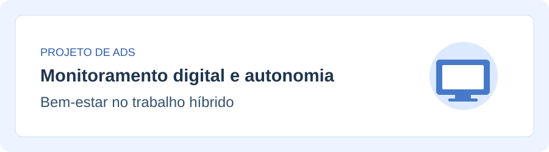

# Monitoramento digital, autonomia e bem-estar no trabalho híbrido



## Visão geral e preview

Este site apresenta dados de pesquisas sobre monitoramento digital, autonomia e bem-estar no trabalho, com foco na discussão sobre jovens profissionais e trabalho híbrido. Ele também possui um planejador simples de pausas, um gráfico de barras e um botão para alternar o tema claro e escuro.

**Repositório:** https://github.com/oVinh/monitoramento-trabalho-hibrido

Página publicada: https://ovinh.github.io/monitoramento-trabalho-hibrido/

## Estrutura de arquivos e diretórios

```text
index.html
css/styles.css
js/planejador.js
js/grafico.js
js/tema.js
dados/pesquisas.json
assets/img/banner.svg
PESQUISA_BASE.md
AUDITORIA_IA.md
README.md
LICENSE
.gitignore
```

## Arquitetura de software e contratos de dados

- `index.html`: contém o conteúdo da página, o menu, o formulário, o gráfico e as perguntas frequentes.
- `css/styles.css`: contém as cores, os estilos, o Grid, o Flexbox e o modo escuro.
- `js/planejador.js`: valida as informações do formulário e calcula as pausas.
- `js/grafico.js`: monta o gráfico de barras com Chart.js e ajusta a cor dos textos de acordo com o tema.
- `js/tema.js`: alterna o tema da página e salva a preferência usando `localStorage`.
- `dados/pesquisas.json`: registra os valores da APA, a fonte e uma observação sobre os limites desses dados.

### Dados do formulário

| Campo | Valores aceitos |
|---|---|
| `horasTrabalho` | Número inteiro de 1 a 12 |
| `intervaloPausas` | Número inteiro de 15 a 180 minutos |
| `duracaoPausas` | Número inteiro de 1 a 30 minutos |

O resultado mostra o número de pausas planejadas e o total de minutos. É um cálculo de organização do tempo, não um diagnóstico médico ou psicológico.

### Dados do gráfico

Cada objeto em `dados/pesquisas.json` tem `nome`, `monitorados` e `nao_monitorados_ou_nao_sabem`. O arquivo `js/grafico.js` usa os mesmos valores diretamente nos seus arrays, para que o gráfico também funcione ao abrir o HTML no computador, sem servidor.

- Estresse: 51% e 38%.
- Microgerenciamento: 47% e 23%.

Os valores representam grupos de trabalhadores pesquisados nos Estados Unidos em 2024, não somente profissionais da Geração Z. A pesquisa mostra associação entre as respostas, não uma relação comprovada de causa e efeito.

## Dependências e CDN

| Dependência | Versão | Finalidade |
|---|---|---|
| Bootstrap | 5.3.3 | Grid responsivo, menu, cards, accordion e badges |
| Chart.js | 4.4.8 | Gráfico de barras |
| Roboto (Google Fonts) | Fonte externa | Tipografia |

Construímos o site com HTML5, CSS3 e JavaScript puro. As bibliotecas externas são importadas via CDN (HTTPS) para otimizar o carregamento. O projeto foi testado e é compatível com as versões recentes do Chrome, Firefox e Safari.

## Matriz de rastreabilidade e colaboração

**Integrantes:** Isaac Ben Fernandes Dos Santos e Guilherme Alves.

| Requisito | Arquivo principal | Desenvolvimento |
|---|---|---|
| Estrutura HTML e Bootstrap | `index.html` | Estrutura inicial desenvolvida pela dupla, com alterações posteriores apoiadas por IA |
| Estilos, Grid e Flexbox | `css/styles.css` | Estilos iniciais desenvolvidos pela dupla, com alterações posteriores apoiadas por IA |
| Planejador de pausas | `js/planejador.js` | Desenvolvimento com copilotagem de IA e revisão da dupla |
| Gráfico e dados | `js/grafico.js` e `dados/pesquisas.json` | Desenvolvimento com copilotagem de IA e conferência dos dados |
| Tema claro/escuro | `js/tema.js` | Desenvolvimento com copilotagem de IA e testes |
| Pesquisa | `PESQUISA_BASE.md` | Pesquisa e interpretação revisadas pela dupla |
| Auditoria da IA | `AUDITORIA_IA.md` | Registro das três interações e revisões da dupla |
| Testes e publicação | GitHub Pages | Deploy e validação de compatibilidade feitos pela dupla. |

Os commits no repositório refletem a divisão real de tarefas entre nós dois.

## Referências bibliográficas

1. American Psychological Association. *2024 Work in America Survey: Psychological Safety in the Changing Workplace*, p. 21. https://www.apa.org/pubs/reports/work-in-america/2024/2024-work-in-america-report.pdf
2. Pendell, R.; Agrawal, S. *Fully Remote Work Least Popular With Gen Z*. Gallup, 22 jul. 2025. https://www.gallup.com/workplace/692675/fully-remote-work-least-popular-gen-z.aspx
3. Microsoft WorkLab. *Breaking Down the Infinite Workday*, 2025. https://www.microsoft.com/en-us/worklab/work-trend-index/breaking-down-infinite-workday

## Transparência sobre o uso de IA

A dupla desenvolveu uma versão inicial do HTML e do CSS. O projeto recebeu posteriormente alterações e recursos elaborados com auxílio do ChatGPT, inclusive em HTML e CSS. A utilização de IA nos scripts e o processo de revisão são apresentados em `AUDITORIA_IA.md`.
